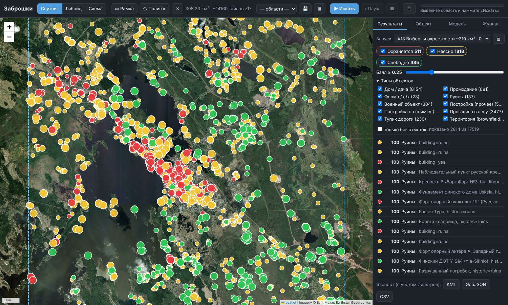
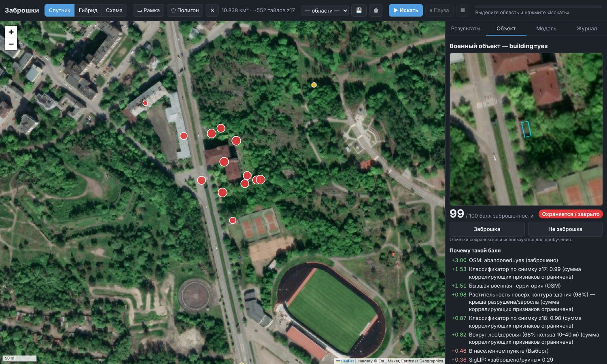
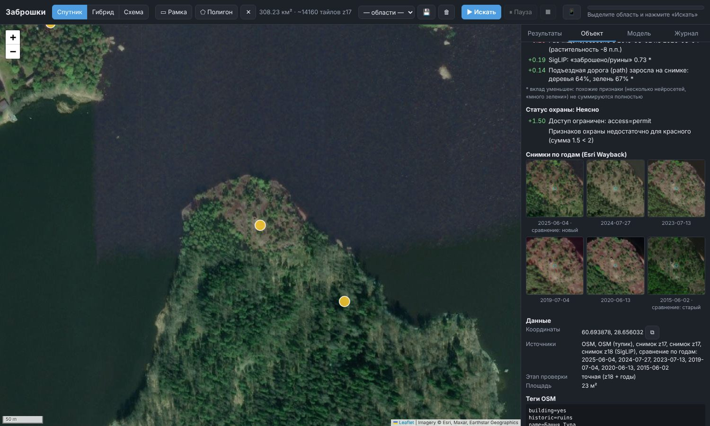
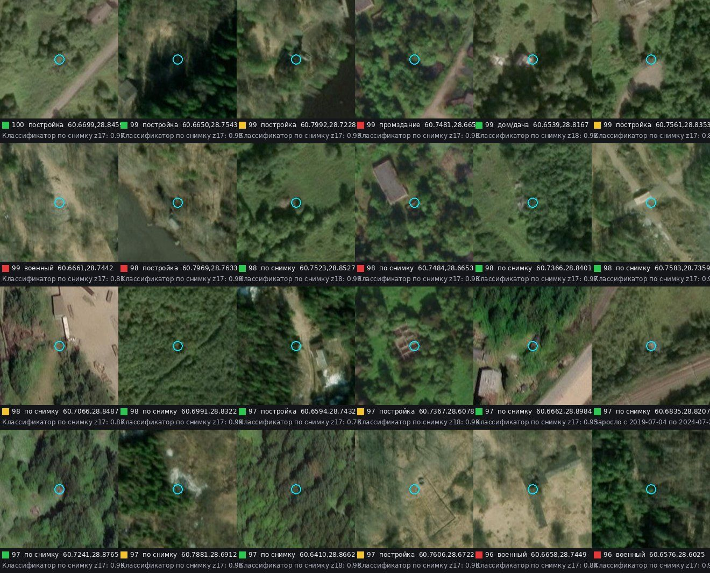
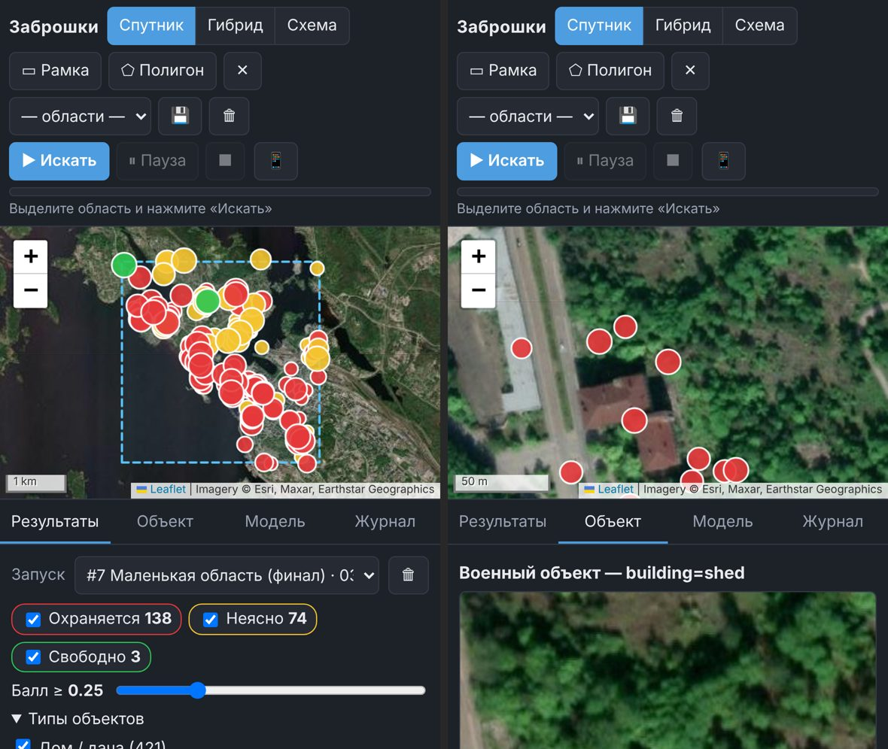

# Заброшки — поиск заброшенных объектов на карте

> Ещё в этом репозитории: **[Steam Price Chart](steam-price-chart/)**, расширение для клиента Steam и браузера.
> Под ценой игры в магазине оно показывает график истории цены со скидками и цены в Казахстане, Украине, России и США в рублях.

Программа для Windows (и [версия для телефона без ПК](#на-телефоне-без-пк)). Выделяете область на карте, программа ищет в ней заброшенные дома, промздания, фермы,
руины, бывшие военные и прочие постройки. Каждый найденный объект показывается маркером, цвет маркера говорит о доступе:

* 🔴 **красный**: охраняется или закрытая территория (военная зона, забор, шлагбаум/КПП, access=private, машины во дворе…);
* 🟢 **зелёный**: свободный доступ (ограждений и признаков использования нет, есть признаки заброшенности);
* 🟡 **жёлтый**: неясно (это значение по умолчанию).

Результат: **ранжированный список кандидатов с баллом 0–100 и причинами**, а не вердикт. Программа сделана с упором на
полноту (recall): лучше показать лишнее с низким баллом, чем пропустить заброшку. Отсекать лишнее удобно ползунком «Балл ≥».
100% точности нет и не будет: снимки бывают старые, кроны деревьев закрывают крыши, OSM неполон. Поэтому в программе есть
отметки «Заброшка / Не заброшка», дообучение по ним и команда оценки качества на ваших примерах.



| Панель объекта | Снимки по годам (Wayback) |
|---|---|
|  |  |

---

## На телефоне без ПК

Отдельная версия для телефона (Android и iPhone) лежит в папке `app/` и работает **целиком на телефоне**, без ПК и
сервера: открываете ссылку в браузере, «Добавить на главный экран», и дальше это обычное приложение.

**Ссылка:** https://ostmat777-png.github.io/Claude/app/

Чтобы ссылка заработала, хостинг GitHub Pages нужно один раз включить (можно с телефона): на github.com откройте
репозиторий `Claude` → **Settings** → **Pages** → в «Build and deployment» выберите **Source: Deploy from a branch**,
**Branch: main**, папку **/ (root)** → **Save**. Через 1–2 минуты ссылка откроется.

Что умеет:

* карта: спутник / гибрид / схема, «где я», **снимки разных лет** (📅: реальные даты съёмки в этом месте или по годам);
* поиск **«Искать на экране»** (видимая часть карты, до ~400 км²) или по **нарисованной пальцем области**;
* те же правила, что на ПК: теги заброшенности OSM только на самом здании (закрытые магазины, снесённое, фонтаны — нет),
  без дач, гаражей, плотной застройки, парков, музеев, строек; **территории одним контуром**; цвет охраны;
* карточка объекта: почему такой балл, признаки охраны, состав территории, ссылки «Яндекс / Google / Навигатор / OSM»,
  статьи Википедии и фото с Викисклада рядом, теги OSM;
* отметки «Заброшка / Не заброшка» и **долгое нажатие на карту** — своя отметка; всё хранится на телефоне;
* сохранённые поиски открываются без интернета; **выгрузка** в KML / GPX / GeoJSON / CSV («Поделиться» → OsmAnd,
  Organic Maps, Locus …);
* **можно выйти из приложения во время поиска**: в Chrome, Яндекс Браузере, Samsung Internet на Android данные OSM
  качает сам браузер (фоновая загрузка, видна в уведомлениях), а когда закончит — нажмите на уведомление или откройте
  приложение, результат посчитается за секунды. Если браузер фоновую загрузку не поддерживает (iPhone) или она
  2 минуты стоит на месте, программа качает на экране и не даёт экрану погаснуть; если поиск всё же прервался, при
  следующем открытии она предложит продолжить — уже скачанное заново не качается.

Чем отличается от версии для ПК: **нет нейросетей по снимкам** (в браузере телефона они не помещаются), поэтому
постройки, которых нет в OSM, телефон не найдёт, и «похоже на ваши примеры» нет. Проверка на Выборге (308 км²):
телефонная версия нашла **все 161** надёжную метку с тегом OSM, которые находит ПК, и не нашла 9 меток, найденных
только по снимкам; весь поиск занял 3 с на ноутбуке (на телефоне — примерно 10–30 с плюс загрузка ~14 МБ данных OSM).

---

## Установка и запуск (Windows 10/11)

1. Скачайте репозиторий (Code → Download ZIP) и распакуйте в папку **без кириллицы и пробелов в пути**, например `C:\Zabroshki`.
2. Дважды щёлкните **`run.bat`**.

При первом запуске `run.bat` сам ставит всё нужное (один раз, 5–15 минут, около 3–4 ГБ):

* менеджер пакетов [uv](https://docs.astral.sh/uv/) и изолированный Python 3.12 в папке `.venv` (системный Python не трогается);
* **PyTorch под вашу видеокарту**: скрипт `tools/detect_gpu.ps1` сам определяет видеокарту и драйвер (таблица ниже);
* библиотеки из `requirements.txt` и веса нейросетей DINOv2 и SigLIP (≈1 ГБ, в `data/models`), затем самопроверка
  моделей на выбранном устройстве.

Дальше каждый запуск `run.bat` сразу открывает окно программы. Окно рисуется встроенным в Windows движком Edge WebView2.
Если WebView2 нет, интерфейс откроется в браузере по адресу `http://127.0.0.1:<порт>/`.

### Видеокарты и процессоры

Программа работает на **любом компьютере**: видеокарта ускоряет нейросети, но не обязательна.

| железо | чем считает | что ставит `run.bat` |
|---|---|---|
| NVIDIA RTX 50xx (Blackwell) | CUDA 12.8 | `cu128` (нужен драйвер 570+) |
| NVIDIA RTX 20xx–40xx, GTX 16xx | CUDA 12.8 / 12.6 | `cu128` при драйвере 570+, иначе `cu126` |
| NVIDIA GTX 900/1000, Titan V | CUDA 12.6 / 11.8 | `cu126` (драйвер 560+) или `cu118` (520+) |
| AMD Radeon (любые с DirectX 12, включая встроенную графику Ryzen) | DirectML | `torch-directml` |
| Intel Arc, Core Ultra (Arc Graphics) | Intel XPU | `xpu` |
| Intel Iris Xe / UHD и прочие DX12-видеокарты | DirectML | `torch-directml` |
| Apple M1–M4 (`run.sh`) | Metal (MPS) | обычный PyTorch |
| AMD на Linux (`run.sh`) | ROCm 6.4 | `rocm6.4` |
| без видеокарты, любые x86-64/ARM процессоры | CPU | `cpu` |

* Размер пачек подбирается по объёму видеопамяти; fp16 включается только на NVIDIA Volta+ и ROCm; на мощных GPU
  детектор работает на 448 px, на встроенных и на CPU — на 224 px.
* При нехватке видеопамяти пачка автоматически уменьшается; если ускоритель даёт сбой, программа **сама
  переключается на процессор** и продолжает (во вкладке «Модель» видно, на чём идут вычисления).
* Если PyTorch вообще не встаёт (например, редкая платформа), программа всё равно запускается и ищет по OSM, контурам
  и классическим признакам снимков — без нейросетей.
* Выбор можно изменить: вкладка «Модель» → «Вычисления» (действует после перезапуска) или переустановить под другое
  устройство: `run.bat --backend cu126` (варианты: `cu128`, `cu126`, `cu118`, `xpu`, `directml`, `cpu`),
  `run.bat --reinstall` — заново определить видеокарту. Linux/macOS: `ZAB_BACKEND=rocm6.4 ./run.sh --reinstall`.

Остальные требования: интернет и 8+ ГБ свободного места под кэш снимков.

Полезные варианты запуска (из `cmd` в папке программы):

```
run.bat                     окно программы
run.bat --browser           открыть интерфейс в браузере
run_lan.bat                 то же + доступ с телефона по Wi-Fi (кнопка «📱» покажет QR-код)
run.bat scan --bbox 60.64,28.60,60.80,28.92 --name "Выборг"   поиск без интерфейса
run.bat evaluate            отчёт о качестве на examples/positives.csv
```

### На телефоне

Сама программа работает только на компьютере (нужны Python и видеокарта), но её интерфейс можно открыть
**на телефоне или планшете в той же Wi‑Fi сети**:

1. Запустите **`run_lan.bat`** (то же, что `run.bat --lan`). Если Windows спросит про брандмауэр, разрешите доступ
   для частных сетей.
2. В окне программы нажмите **«📱»** и отсканируйте QR-код камерой телефона (ссылка также печатается в консоли).
3. На телефоне откроется та же карта: фильтры, панель объекта со снимками по годам, кнопки «Заброшка / Не заброшка».
   Скан и нейросети при этом работают на компьютере.

Ссылка содержит секретный ключ: без него программа с других устройств не открывается. Для работы в поле без
компьютера экспортируйте результаты в **KML** и откройте их в OsmAnd, Organic Maps или Google Earth на телефоне.

Все данные хранятся в папке `data/`:

| путь | содержимое |
|---|---|
| `cache.sqlite` | тайлы снимков и ответы Overpass/Wayback |
| `app.sqlite` | области, запуски, кандидаты, отметки, эмбеддинги, модели |
| `models/` | веса нейросетей |
| `exports/` | экспорт KML/GeoJSON/CSV |
| `zabroshki.log` | журнал |

Повторный поиск по той же области ничего не скачивает заново.

---

## Как пользоваться

1. **Подложка**: «Спутник» (Esri World Imagery), «Гибрид» (спутник + подписи) или «Схема» (OpenStreetMap).
   **Дата снимка** (архив Esri Wayback, с 2014 года): в списке «📅» выберите год (2026, 2025, …, 2020, …, 2014)
   или нажмите **📍**, чтобы увидеть *реальные даты съёмки в этом месте карты* (например, 2025-06-04, 2019-07-04,
   2010-07-05). Кнопки ◀ ▶ листают снимки назад и вперёд. «Гибрид» работает с выбранной датой, «📅 Текущий снимок»
   возвращает обычный слой. По годам показан последний выпуск архива за год: если в этом месте снимок не обновлялся,
   там может оказаться более старая съёмка. Точные даты показывает 📍.
2. **Область**: кнопка «▭ Рамка» или «⬠ Полигон». Рядом показываются площадь и число тайлов скана.
   Кнопка 💾 сохраняет область, список «— области —» её загружает.
3. **«▶ Искать»** запускает поиск. Прогресс-бар показывает этап, счётчик и оставшееся время, «⏸ Пауза» и «▶ Продолжить»
   приостанавливают поиск, «■» останавливает его (найденное к этому моменту сохраняется). Промежуточные результаты
   появляются на карте уже во время поиска.
4. **Фильтры** справа: цвета (с количеством), ползунок «Балл ≥» и типы объектов (дом/дача, промздание, ферма, руины,
   военный объект, постройка по снимку, прогалина, тупик дороги, территория / комплекс).
   * **«только надёжные»** (включено по умолчанию): режим «мало, но верно», см. ниже. Снимите галочку, чтобы увидеть
     всех кандидатов (режим полноты);
   * **«части комплексов»**: показывать отдельные здания, входящие в территорию (по умолчанию видна одна метка и
     пунктирный контур на всю территорию);
   * **«без отметок»**: скрыть то, что вы уже отметили.
5. **Клик по маркеру** (или по строке списка) открывает панель объекта:
   * кроп со спутника с контуром здания (клик увеличивает);
   * балл и **список причин с весами** (зелёные повышают балл, красные понижают);
   * статус охраны и его причины;
   * **снимки по годам** (Esri Wayback), пара для сравнения подписана «старый / новый»;
   * координаты (кнопка ⧉ копирует), источники, теги OSM;
   * ссылки «Открыть в Google Maps» и OSM;
   * кнопки **«Заброшка» / «Не заброшка»**;
   * у территории: список её зданий (клик по зданию открывает его), выбранный объект обводится голубым контуром.
6. **Пропущенная заброшка или ложная точка там, где маркера нет**: **правый клик по карте** (долгое нажатие на
   телефоне) → «✔ Здесь заброшка» или «✘ Не заброшка». На карте появится ★ или ✕ (клик по ней удаляет отметку).
   Такие отметки идут в обучение и в оценку качества: после «Дообучить и пересчитать» программа ищет похожие объекты.
7. **Дообучение**: вкладка «Модель», кнопка «↻ Дообучить и пересчитать». Классификаторы переобучаются на ваших примерах
   и отметках, веса признаков подстраиваются под отметки, ранжирование пересчитывается без повторных скачиваний.
8. **Экспорт**: кнопки KML / GeoJSON / CSV. Экспортируется то, что проходит текущие фильтры. Файл сохраняется в
   `data/exports`, рядом ссылки «скачать» и «открыть папку». KML открывается в Google Earth, OsmAnd, Organic Maps и т.п.

---

## Как устроен поиск

Поиск многоступенчатый: сначала дешёвый сплошной скан всей области, потом точная проверка лучших кандидатов.
Дубли из разных источников сливаются по расстоянию: два контура объединяются, если пересекаются, точки сливаются
в радиусе 15–60 м в зависимости от типа.

| этап | что делает |
|---|---|
| 1. OSM (Overpass) | `abandoned=*`, `disused=*`, `ruins=*`, `abandoned:*`/`disused:*`/`ruins:*` (building, amenity, military, railway…), `building=ruins`, `historic=ruins`, `landuse=brownfield`, `military=*`, `landuse=military`, все здания, дороги, заборы/ворота/КПП, `access=private`, населённые пункты и садоводства. Запрос режется на фрагменты, у каждого фрагмента свой кэш. Зеркала Overpass перебираются с паузами, упавший фрагмент делится на 4 части. |
| 2. Контуры зданий | Microsoft Global ML Building Footprints (Выборг покрыт). Контуры, которых нет в OSM, становятся отдельными кандидатами. |
| 3. Кандидаты и контекст | Все постройки, объекты с тегами заброшенности, тупики `track/service/path` вне населённых пунктов. Для каждого считается контекст: вне посёлков/в садоводстве/в городе, расстояние до дорог и их тип, заборы, ворота, КПП, военные и промзоны, соседние действующие объекты. |
| 4–5. Сплошной скан снимков | Все тайлы области на z17 (≈0,58 м/пикс). Классические индексы: ExG (зелень) и текстура дают маску деревьев и травы. **DINOv2**: патч-токены каждого тайла. **Детектор зданий** (логистическая регрессия на токенах) обучается на лету на контурах OSM+MS этой же области и находит постройки, которых нет ни на одной карте (только в лесу и вне застройки). Отдельно ищутся **прогалины в лесу**. Для каждого кандидата: деревья поверх контура (крыша провалилась или заросла), деревья и зелень во дворе, **заросшесть относительно соседей в радиусе 300 м**, «читается ли крыша» по детектору. |
| 6. Модель на примерах | **Классификатор A** на эмбеддингах DINOv2 (тот же источник и масштаб z17, что у скана). Позитивы: `examples/positives.csv` + ваши отметки + объекты OSM с тегами заброшенности (как слабые примеры). Негативы: случайные обычные дома региона, подобранные так, чтобы доля леса вокруг была как у позитивов (иначе модель учит «вокруг деревья ⇒ заброшка»). |
| 7. Точная проверка | Топ-K кандидатов (по умолчанию 1500) на z18 (≈0,29 м/пикс): **SigLIP** zero-shot по трём группам описаний («заброшено/руины», «ухожено/машины», «построек нет»), детектор машин, **классификатор B** на эмбеддингах SigLIP. |
| 8. Сравнение по годам | **Esri Wayback**: для тайла находятся реально различные версии снимка (через `tilemap`, без перебора 190+ релизов), даты съёмки берутся из metadata. Сравнивается новейший летний снимок с самым старым летним снимком минимум на 3 года раньше: заросло ли (деревья на крыше, во дворе), пропала ли крыша (детектор), насколько изменилась сцена (эмбеддинги). Снимки разных сезонов распознаются (на 60° с.ш. в мае листвы ещё нет), их вес снижается. |
| 9. VLM (опционально) | Если запущен [Ollama](https://ollama.com) с визуальной моделью (по умолчанию `qwen2.5vl:7b`, помещается в 16 ГБ), топ-60 кандидатов дополнительно проверяются: состояние крыши, заросшесть, машины, забор, будка охраны, следы использования. |
| 10. Итог | Балл и статус охраны. |

### Балл

Балл считается как сумма лог-шансов признаков: `p = σ(bias + Σ wᵢ·xᵢ)`. Каждое слагаемое показывается в панели как
причина с весом. Коррелирующие признаки (несколько нейросетей; лес, заросшесть и деревья на крыше; удалённость;
история снимков) суммируются с ограничением, чтобы «много деревьев» не засчитывалось пять раз.

Главные признаки: OSM-теги заброшенности (+3), бывшая военная территория, вне населённых пунктов, подъезд только по
грунтовке или тропе, тупиковая дорога к объекту, одиночная постройка, лес вокруг, растительность поверх контура
(провалившаяся или заросшая крыша), участок заметно заросший относительно соседей, крыша «не читается» на снимке,
классификаторы A/B, SigLIP, рост растительности и исчезновение крыши по годам, ответ VLM. Понижают балл: населённый
пункт, соседние магазины и учреждения, машины во дворе, «расчищено» на последних снимках.

### Сведения об объекте: история, фото, состояние и охрана

В панели объекта есть раздел **«Сведения об объекте»**. Он загружается при открытии объекта из открытых бесплатных
источников без ключей и кэшируется на 30 дней (кнопка ↻ загружает заново):

* **описание по данным программы**: тип, площадь, расположение, что видно на снимке, что изменилось по годам;
* **Википедия** (ru/en/fi, финская полезна для истории Выборга): краткое описание статьи;
* **Wikidata**: год постройки, архитектор, охранный статус памятника, состояние (руины, снесён), закрытие;
* **теги OSM**: название, финское и шведское названия, год, описание, примечания, отметки заброшенности;
* **«Состояние и заброшенность»** и **«Охрана и доступ по источникам»**: фразы из статей и описаний
  (разрушен, пожар, аварийное, огорожено, сторож, собаки, камеры, частная территория, вход свободный…) со ссылкой
  на первоисточник. Охрана памятника («объект культурного наследия») к охране территории не относится и не попадает;
* **фотографии рядом**: Wikimedia Commons (с автором и лицензией) и уличные фото **Panoramax** (CC-BY-SA, с пометкой
  «смотрит на объект»), клик увеличивает;
* **ссылки для поиска**: Wikimapia, Яндекс Карты (панорамы), поиск в Яндексе и Google, поиск по urban3p.ru через
  Яндекс.

Способы обойти ограждение или охрану программа не собирает. Сведения об охране показываются только для безопасности
и чтобы было видно, законно ли туда идти. Wikimedia ограничивает частоту запросов: если источник временно недоступен,
это видно внизу раздела, и через некоторое время можно нажать ↻.

### Подтверждение меток (✔)

Балл — это ранжирование, а «✔» значит, что заброшенность подтверждают **минимум два независимых источника** и нет противоречий:

1. **OSM**: объект отмечен как заброшенный/руины;
2. **снимок**: нейросети z17 и z18 уверены и объект выделяется среди соседей, или крыша видна, но заросла,
   или SigLIP видит руины. Это **один** источник: все модели смотрят на один и тот же снимок и ошибаются одинаково;
3. **история снимков (Wayback)**: крыша была и исчезла, или участок зарос (сравнение в одном сезоне);
4. **VLM** (Ollama): заброшено с вероятностью ≥ 0,6.

Противоречия снимают подтверждение: машины во дворе, участок недавно расчищен, VLM видит следы использования,
«постройки на снимке нет», контур не подтверждён детектором, объект не выделяется среди соседей. Постройку,
которую не видно на снимке (полностью под деревьями), подтвердить по снимку нельзя, и программа так и пишет.

В списке и на маркере (голубая обводка) показывается «✔N». Подтверждение входит в правило «надёжной метки»
(фильтр «только надёжные», см. ниже), экспорт учитывает этот фильтр. Без Ollama подтверждение даёт только связка «снимок + история» или «OSM +
снимок». Если установить Ollama с `qwen2.5vl:7b`, VLM в первую очередь проверяет сильные, но ещё не подтверждённые
кандидаты (по умолчанию 150). Это самый полезный независимый второй взгляд, и на RTX 5060 Ti он работает быстро.

На тестовой области: из 1 860 меток с баллом ≥ 0,25 подтверждены 177 (без VLM), из них 19 без тегов OSM.

### Охрана (эвристика, по умолчанию «неясно»)

Красный ставится, если сумма признаков охраны ≥ 2. Учитываются:
* военная территория (+2), а если она отмечена как бывшая, то +0,5;
* `access=private/no` (+1,5);
* объект внутри замкнутого забора (+1,5), забор или стена ближе 35 м (+1);
* будка охраны/КПП/`building=guardhouse` в 200 м (+2), шлагбаум (+1,2), ворота (+0,6);
* действующая промзона (+0,8), коммерческая территория, соседние действующие объекты, жильцы рядом;
* машины во дворе на снимке (+1), участок расчищен на последних снимках (+0,8);
* забор, будка и машины по ответу VLM.

Зелёный ставится, когда признаков охраны почти нет, рядом нет ограждений и ворот, а балл заброшенности ≥ 0,35.
Всё остальное жёлтое. Все причины видны в панели.

---

### Режим «мало, но верно» (по умолчанию)

На карте по умолчанию только **надёжные** метки. Надёжная метка:

* балл ≥ 0,5 и **ничто не противоречит** (парк, музей, памятник, стройплощадка, обычный дом в плотной
  застройке, машины во дворе, VLM видит следы использования …);
* и заброшенность **подтверждена**: тег заброшенности OSM на самом здании (руины, `abandoned:building`,
  `disused:amenity=school` …) **или** два независимых источника, причём хотя бы один **сильный**: обе нейросети
  уверены и объект выделяется среди соседей, крыша исчезла между снимками разных лет или VLM уверен. Связка
  «заросло + SigLIP» сама по себе надёжной не считается: так выглядит и работающая база в лесу, и запущенный огород;
* **дачи, садоводства, гаражи и плотная застройка без тега OSM надёжными не бывают никогда.**

Что программа больше не считает заброшкой:

* закрытый магазин, кафе или офис в работающем доме (`disused:shop=…` на точке внутри здания раньше делал
  «заброшенным» весь дом);
* снесённые объекты (`was:building`, `demolished:…`): на месте уже ничего нет;
* заброшенные фонтаны, колодцы, платформы, заборы, ворота и памятники: это не здания;
* стройплощадки (`landuse=construction`, а также `brownfield` с названием «Строительство ЖК …»);
* всё внутри парков и музеев (например, Монрепо): для этого поиск теперь загружает из OSM парки, музеи и ООПТ.
  **Нужен новый поиск**: в старых запусках этих данных нет. ООПТ (заказники, заповедники) — лишь слабый минус, не запрет:
  там часто и стоят заброшенные военные объекты. Руина с пометкой «достопримечательность» не исключается.

**Территории.** Если тег заброшенности стоит на территории (`landuse=brownfield`, заброшенная воинская часть и т.п.)
или несколько подозрительных зданий стоят в пределах 40 м друг от друга, программа показывает одну метку с пунктирным
контуром на всю территорию вместо россыпи точек. Цвет охраны территории: красный, если хоть одно здание красное.
Территория надёжна, если надёжно хотя бы одно её здание. Мелкие пристройки (< 120 м²) рядом с крупным зданием
считаются его частью. Точка с тегом OSM ставится там, где её поставили в OSM, и не «прилипает» к соседнему дому
(раньше она притягивалась к любому зданию в 20 м).

Старые запуски можно пересчитать по новым правилам без скачиваний: вкладка «Модель» → «↻ Дообучить и пересчитать».

## Обучение на ваших примерах

`examples/positives.csv`: по одной заброшке в строке (широта, долгота, комментарий):

```
lat,lon,comment
60.71234,28.74567,заброшенный дом в лесу
60.69876,28.81234,ферма без крыши
```

Понимается почти любая запись: разделитель `,`, `;`, табуляция или пробел; десятичная точка или запятая; градусы-минуты
(`60°42'44"N 28°44'44"E`); ссылки из Google/Яндекс Карт; заголовок можно не писать. Файл, который Блокнот сохранил как
`positives.csv.txt`, тоже находится. **Нужна точность**: 5 знаков после точки (≈1 м). `60.7, 28.7` — это ±5 км, такие
строки не принимаются. Во вкладке «Модель» видно, сколько примеров прочитано, и какие строки не распознаны. Сами
примеры показаны на карте значком ☆. `examples/negatives.csv` (в том же формате) — явные «не заброшки».

**«≈ Похоже на ваши примеры».** От 3 примеров (файл + отметки «Заброшка») программа обучает отдельную модель
**только на ваших примерах** (в общей модели их заглушают ~180 руин с тегами OSM) и показывает до 25 объектов,
которые сильнее всего выделяются среди соседей **и** сходством с вашими примерами, **и** общей оценкой заброшенности,
при этом проверены на снимке и без противоречий (машины, расчистка, «постройку не видно»). Они видны по умолчанию с
фиолетовой пунктирной обводкой: проверьте по снимку и нажмите «Заброшка» или «Не заброшка», это лучший способ
обучить программу. Если ваши примеры в дачах или плотной застройке, похожие ищутся и там (при «Дообучить» недостающие
снимки докачиваются). Проверка на Выборге с 15 примерами: из 15 отложенных заброшек большинство попало в верхние 10 %
по сходству; среди «похожих» примерно половина правдоподобна на снимке — это подсказки, а не надёжные метки.

Ваши отметки «Заброшка» показываются на карте всегда, отметки «Не заброшка» в обычном виде скрываются. Отчёт
«📊 Оценить качество» пишет для каждого вашего примера, **почему он не на карте** (нет ни на одной карте → только
полный режим; дачи без тега OSM; балл; противоречие …).

* Снимки для обучения скачиваются из того же источника и в том же масштабе, что и при скане (z17 для A, z18 для B).
* Негативы берутся автоматически: случайные обычные дома в посёлках и садоводствах региона.
* **Активное обучение**: кнопки «Заброшка / Не заброшка» сохраняются в базе (по координатам, переживают повторные
  поиски). По кнопке «Дообучить» переобучаются классификаторы A и B и подбираются веса признаков. Это логистическая
  регрессия с регуляризацией к исходным весам, включается от 3 отметок каждого класса. Затем список
  пересортировывается.
* **Оценка качества**: `run.bat evaluate`. Отчёт сохраняется в `data/eval_run<N>.md` и коротко показывается во
  вкладке «Модель». В нём:
  * для каждого вашего примера: найден ли кандидат в 40 м, его балл, место в списке, цвет, главные причины,
    плюс полнота при балле ≥ 0,1/0,25/0,5 и в топ-50/100/200/500;
  * **слепой тест** на объектах OSM с тегами заброшенности: теги скрываются, классификатор пересчитывается по фолдам
    без утечки, и проверяется, нашлись бы эти объекты только по снимкам и контексту.

---

## Настройки (`data/settings.json`, часть есть во вкладке «Модель»)

| ключ | по умолчанию | смысл |
|---|---|---|
| `scan_zoom` | 17 | зум сплошного скана (18 даёт в 4 раза больше тайлов, но детальнее) |
| `crop_zoom` | 18 | зум точной проверки |
| `stage_b_top_k` / `wayback_top_k` / `vlm_top_k` | 1500 / 400 / 60 | сколько кандидатов проверять точно, по годам и через VLM |
| `rate_limits` | Esri 8/с, Wayback 6/с, OSM-тайлы 2/с | вежливые лимиты запросов к серверам тайлов |
| `overpass_urls` | overpass-api.de, maps.mail.ru, kumi, private.coffee | зеркала Overpass по порядку |
| `imagery_provider` | `esri` | источник снимков |
| `custom_providers` | `{}` | свои XYZ-источники: `{"id": {"name": "...", "url": "https://.../{z}/{x}/{y}.jpg", "max_zoom": 19, "kind": "sat"}}` |
| `dino_model` / `dino_input` | `facebook/dinov2-small` / auto (448 на GPU) | на 16 ГБ можно `facebook/dinov2-base` |
| `siglip_model` | `google/siglip-base-patch16-224` | |
| `use_vlm`, `ollama_url`, `ollama_model` | auto, `http://127.0.0.1:11434`, `qwen2.5vl:7b` | |
| `contact` | `""` | ваш e-mail/URL для заголовка User-Agent (по желанию: так операторы серверов карт смогут связаться при проблемах; по умолчанию никаких личных данных не отправляется) |
| `min_score_keep` | 0.05 | ниже этого балла кандидаты не показываются (полнота важнее, порог низкий) |

**VLM (по желанию):** установите Ollama, выполните `ollama pull qwen2.5vl:7b` и держите Ollama запущенным.
Программа подключит модель сама.

Google Maps/Earth программа не парсит: это запрещено их условиями. Ссылка «Открыть в Google Maps» просто открывает
место в браузере. Снимки берутся из Esri World Imagery и Esri Wayback с соблюдением лимитов и кэшем на диске.

---

## Как программа сработала на тестовой области (Выборг)

Прогон на прямоугольнике **60.64–60.80 с.ш., 28.60–28.92 в.д. (308 км²)**: город, дачи, промзоны, леса.
Для сравнения сначала была маленькая область 11 км² в центре Выборга.

| что | результат |
|---|---|
| Снимки | 14 160 тайлов z17 (+ кропы z18 для 1 618 кандидатов, Wayback для 400) |
| OSM | 19 029 зданий, 306 объектов с тегами заброшенности, 45 военных, 17 тыс. дорог, 5,8 тыс. ограждений |
| Microsoft Footprints | 40 858 контуров, 25 768 из них нет в OSM |
| Детектор зданий по снимку | AUC **0,966** на отложенных тайлах (обучен на лету на контурах OSM+MS) |
| Классификаторы A / B | AUC на кросс-валидации **0,91 / 0,92** (200 объектов OSM с тегами заброшенности против 1 200 обычных зданий региона) |
| Кандидатов всего | 51 163; с баллом ≥ 0,25: 2 814 (🔴 511 / 🟡 1 818 / 🟢 485); с баллом ≥ 0,5: 894 |

**Слепой тест**: проверка, нашла бы программа объекты без подсказки OSM. Теги abandoned/ruins/disused
у 200 объектов скрыты, классификатор A пересчитан по фолдам (без утечки), классификатор B не используется.

| метрика | значение |
|---|---|
| AUC (эти 200 объектов против всех 51 тыс. кандидатов) | **0,79** |
| медианное место такого объекта в общем списке | **7,8 %** списка |
| найдено при балле ≥ 0,1 / ≥ 0,25 / ≥ 0,5 | 62 % / 46 % / 18 % (под порог попадает 15 % / 5 % / 1,4 % всех кандидатов) |

Что важно знать про эти цифры:
* **Ваших примеров в репозитории не было** (`examples/positives.csv` пуст), поэтому качество мерилось на объектах OSM.
  Эта выборка смещена: в Выборге это в основном исторические руины и форты крепости, часто в городе. Ваши цели
  (дома в лесу, фермы, дачи) выглядят иначе. Настоящую полноту на ваших примерах покажет «📊 Оценить качество».
* Первые версии весов давали на этом тесте AUC 0,57. Разбор показал две проблемы, обе исправлены:
  1. классификатор учил «не посёлок = заброшка»: негативы брались только из посёлков, теперь берутся из
     обычных зданий всего региона;
  2. «зелёные» признаки (лес вокруг, деревья на крыше) в лесистом регионе не различают заброшки, их вес снижен.
  Часть весов настроена с оглядкой на этот же тест (кросс-валидационная оценка того же подхода: 0,79).
* Контуры Microsoft в лесу часто оказываются ложными срабатываниями на кронах деревьев. Если наш детектор не видит
  там здания, контур помечается неподтверждённым и получает низкий балл.
* Прогалины (3,5 тыс.) и тупики дорог остаются в списке с низким баллом: это требование полноты.

**После перехода на «мало, но верно»** (тот же запуск, пересчитан по новым правилам): из 28 957 кандидатов на карте
по умолчанию **149 надёжных меток**: 108 руин, 17 домов, 15 территорий, 6 построек, 3 военных объекта. 129 из них
имеют тег заброшенности OSM на самом здании, остальные подтверждены снимком и историей снимков. Без галочки
«только надёжные» видно 477 меток. Цена точности: в слепом тесте (теги OSM скрыты) балл ≥ 0,5 получает лишь 0,5 %
таких объектов, AUC 0,69. Объекты без тега OSM показываются, только когда есть сильные признаки. Пропущенные
заброшки отметьте правым кликом и нажмите «Дообучить и пересчитать».

Лучшие кандидаты **без тегов OSM** (то, чего нет на картах) на тестовой области:



На телефоне (режим `run_lan.bat`):



## Производительность (ориентиры)

* Область ~300 км² вокруг Выборга: ≈14 000 тайлов z17. Первое скачивание при 8 запросах/с занимает ≈30 мин,
  повторные запуски идут из кэша.
* DINOv2-small, скан: на CPU (4 ядра, 224 px) 14 160 тайлов заняли ≈13 мин, на RTX 5060 Ti (448 px, fp16) в разы быстрее.
* Полный прогон 308 км² на CPU без GPU: скан и признаки ≈30 мин, точная проверка z18 ≈30 мин (вместе со скачиванием),
  Wayback для 400 кандидатов ≈23 мин.
* OSM через Overpass: на загруженных публичных серверах фрагмент может отвечать минутами, программа ждёт и
  переключает зеркала. Результат кэшируется на 14 дней.

### Быстрый режим (по умолчанию) и конвейер

В режиме «мало, но верно» почти всё время раньше уходило на то, что надёжной меткой стать не может. Теперь
(вкладка «Модель» → «Режим поиска»):

* **быстрый** (по умолчанию):
  * снимки z17 скачиваются и сканируются **только там, где есть постройка, способная стать надёжной меткой**.
    Не нужны пустой лес, поля, вода и кварталы дач и плотной застройки без тегов заброшенности OSM. Проверено на
    Выборге: из 3 578 построек, найденных только по снимку (их нет ни в OSM, ни в контурах Microsoft), ни одна не
    набрала даже 0,5 балла, а все надёжные метки — здания, которые есть на картах. Поиск «того, чего нет ни на одной
    карте», и прогалин остаётся в полном режиме;
  * **точная проверка z18** только для тех, кто ещё может стать надёжной меткой: объекты с тегом OSM, военные и
    кандидаты, у которых классификатор по снимку z17 ≥ 0,5. На Выборге 312 вместо 1 618;
  * классификатор B учится на 3 «обычных» зданиях на один пример вместо 6: каждое стоит снимка z18;
  * **Wayback** до 250 объектов: сначала кандидаты без тега OSM, которых одобрили обе нейросети (история снимков им
    нужнее всего как второй источник), затем объекты с тегом OSM. Лимит этапа 25 мин;
* **полный**: всё подряд, как раньше, кроме открытой воды без построек (её видно по обзорному снимку z14, он в 64 раза
  дешевле; берега и острова сканируются всегда). Нужен, если вы смотрите все кандидаты (галочка «только надёжные»
  снята) или ищете постройки, которых нет на картах.

**Замер на Выборге (308 км², облачный CPU, снимки и OSM уже в кэше):**

| этап | раньше (всё подряд) | быстрый режим |
|---|---|---|
| тайлов z17 скачать и просканировать | 14 160 | 1 583 |
| сплошной скан | 31 мин | 3 мин 40 с |
| точная проверка z18 (кандидатов / время) | 1 618 / 29 мин | 312 / 3 мин |
| Wayback (кандидатов / время) | 400 / 23 мин | 250 / 2 мин 50 с |
| **весь поиск** | **~1 ч 25 мин** (без учёта OSM) | **12 мин 22 с** (с OSM) |
| надёжных меток | 158 зданий | 153 здания, 135 из них те же |

Дома при первом поиске добавляется скачивание снимков. Раньше это было ~14 тыс. тайлов z17 и ~11 тыс. тайлов z18
(~50 мин при вежливых 8 запросах/с), теперь ~2,1 тыс. z17 (вместе с выборкой для обучения детектора) и ~4 тыс. z18
(~13 мин), причём z17 качаются одновременно с OSM и сканом. Повторный поиск в той же местности берёт снимки из кэша.
Разница в надёжных метках: 8 пропавших — руины в Монрепо и форты на музейных территориях (так и задумано: теперь
загружаются парки и музеи). Остальное — уточнение тегов OSM (закрытые магазины, «прилипание» точек) и обычный разброс
переобученных классификаторов. Чтобы в быстром режиме не искажалось сравнение «объект против соседей», когда соседние
тайлы не сканировались, программа берёт фон по обычным зданиям такой же застройки во всём регионе.

**Конвейер** (в обоих режимах):

* тайлы, которые почти наверняка понадобятся, и тайлы для обучения детектора качаются **в фоне, пока грузится OSM**;
* сплошной скан идёт **одновременно со скачиванием**, а не после него;
* даты снимков Wayback собираются в фоне **во время точной проверки z18**;
* к Overpass уходит 2 запроса одновременно (больше публичные серверы не разрешают).

Лимиты частоты запросов к серверам тайлов не менялись: время выиграно за счёт того, что ненужное не скачивается, а
независимые этапы идут одновременно. В конце поиска в журнале пишется **время каждого этапа**. Если поиск всё равно
долгий, пришлите эту строку: будет видно, что именно тормозит.

После «Дообучить и пересчитать» кандидаты, ставшие перспективными (например, благодаря вашим отметкам), получают
недостающую проверку z18 (до 300 штук, докачивается немного снимков).

### Что ускорено ещё

* Точки-дубли (тупики, прогалины, неподтверждённые контуры, мелкие пристройки) склеиваются с основным зданием
  **до** дорогих этапов, поэтому точная проверка и Wayback тратятся на разные объекты, а не на соседние точки одного.
  На тестовой области это 1 854 точки на малой области и около 11 тыс. на большой.
* Wayback опрашивает тайлы параллельно, у него короткие тайм-ауты, автоотключение при недоступности сервера и
  лимит этапа 40 минут.
* Подъездные дороги проверяются только там, где это влияет на балл (вне посёлков и плотной застройки).
* На GPU точная проверка усредняет 4 поворота снимка (TTA), ложных срабатываний от ракурса меньше.

## Если что-то пошло не так

* **Видеокарта не используется** (во вкладке «Модель» написано CPU): обновите драйвер видеокарты (NVIDIA 570+ для
  RTX 50xx), затем `run.bat --reinstall`. Можно указать вариант вручную: `run.bat --backend directml` (AMD/Intel) или
  `run.bat --backend cu126` (старые NVIDIA). Какую видеокарту нашёл установщик — в начале `install.log`.
* **Переустановка с нуля**: удалите папку `.venv` и запустите `run.bat`. Кэш в `data/` сохранится.
* **Пустое окно**: запустите `run.bat --browser`.
* **OSM не скачивается** (все зеркала Overpass недоступны): поиск продолжится по контурам Microsoft и снимкам,
  в журнале будет предупреждение. Повторите позже, скачанные фрагменты сохранятся.
* Журнал лежит в `data/zabroshki.log`, вкладка «Журнал» показывает последние сообщения.

## Источники и лицензии

* Снимки: Esri World Imagery и World Imagery Wayback (© Esri, Maxar, Earthstar Geographics и др.). Используйте по
  условиям Esri.
* © участники OpenStreetMap, ODbL. Microsoft Global ML Building Footprints, ODbL.
* Модели: DINOv2 (Meta, Apache-2.0), SigLIP (Google, Apache-2.0). Опционально Qwen2.5-VL через Ollama.
* Интерфейс: Leaflet, Leaflet.draw (BSD).

Программа помогает с разведкой. Перед посещением объекта убедитесь, что это законно и безопасно: заброшенные здания
опасны, а территория может быть частной или охраняемой, даже если на карте маркер зелёный.
