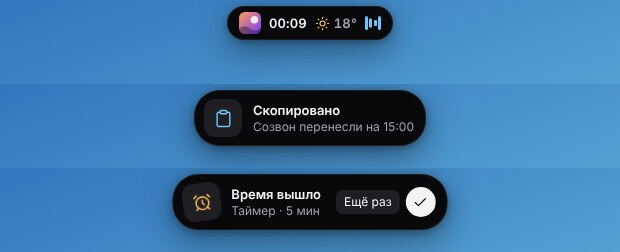
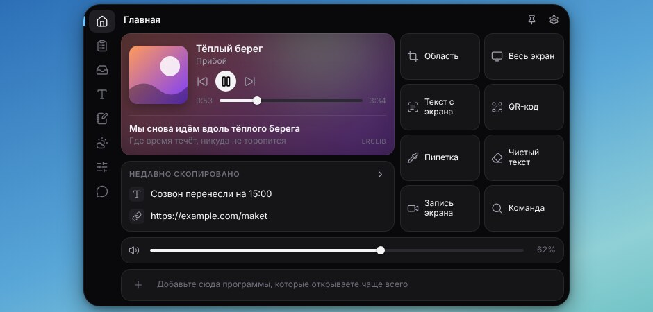
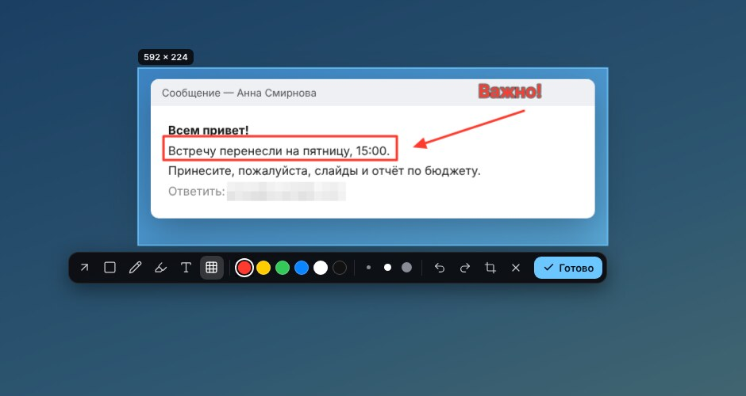
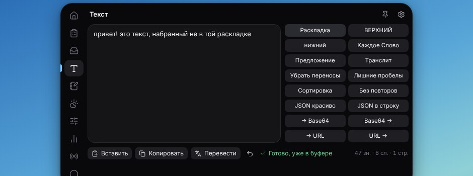
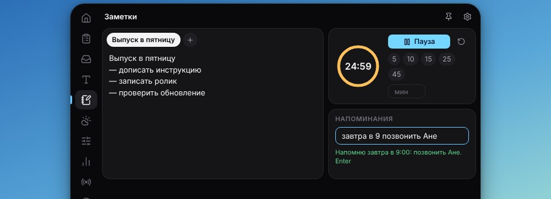
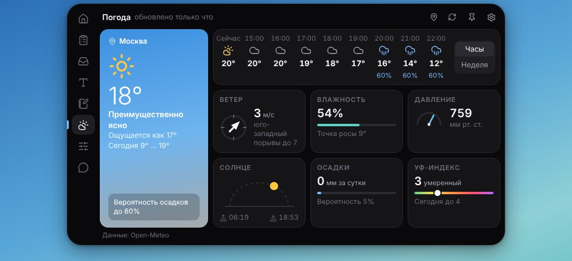
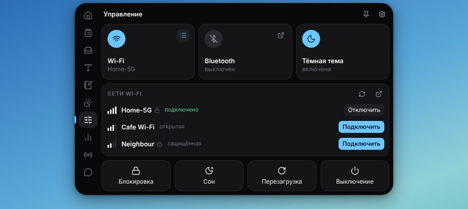
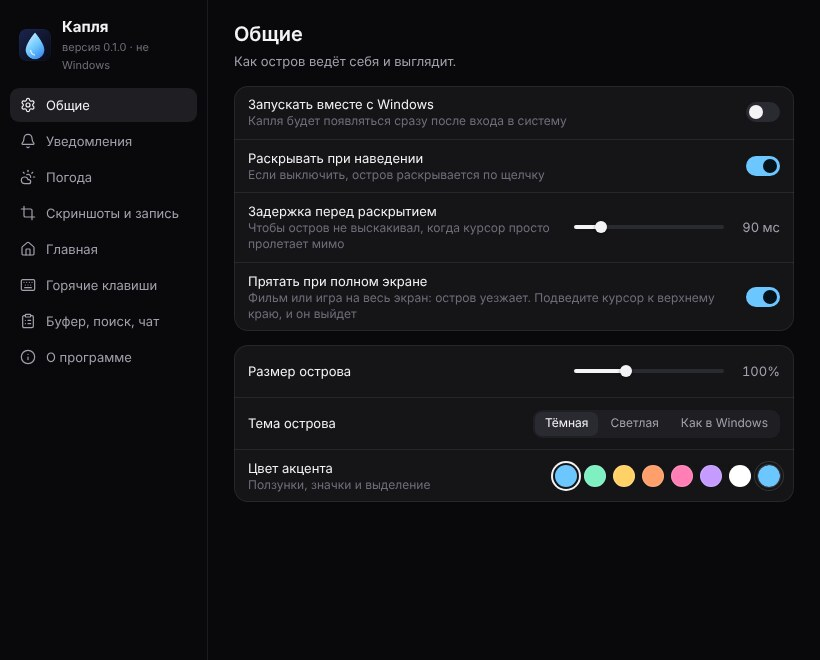

# Капля: островок в верхней части экрана Windows

Маленькая чёрная «пилюля» у верхнего края экрана. В свёрнутом виде она показывает время, погоду и то, что сейчас
играет. Наведите на неё курсор, и она раскроется в панель: плеер, буфер обмена, скриншоты, заметки, погода,
переключатели Wi-Fi и Bluetooth. Для Windows 10 и 11.





## Что умеет

**Свёрнутый остров.** Часы, погода, обложка и «столбики» играющей музыки, обратный отсчёт таймера, индикатор записи
экрана с кнопкой «Стоп». На секунду раскрывается сам, когда вы что-то скопировали, сменился трек, готов скриншот,
сработал таймер или напоминание.

**Главная.** Плеер, последние скопированные записи, восемь быстрых кнопок, громкость, строка ваших программ. Что из
этого показывать, выбирается в настройках.

* **Плеер** видит и программы (Spotify, Яндекс Музыка, AIMP), и сайты в браузере (YouTube, Яндекс Музыка, VK Музыка,
  Spotify в Chrome, Edge, Яндекс Браузере, Firefox). Если играет несколько, над текстом песни появляются кнопки,
  чтобы выбрать, за каким следить. Карточка окрашивается в цвет обложки. Если плеер не отдал обложку, она ищется по
  названию трека.
* **Текст песни** идёт строка за строкой; нажмите на него, и откроется весь текст с подсвеченной текущей строкой.
  Щелчок по строке перематывает к ней.
* **Сердечко** ставит лайк в самом плеере: Капля находит кнопку «Нравится» в окне программы или во вкладке
  браузера и нажимает её (окно плеера не должно быть свёрнуто, а во вкладке должен быть открыт этот трек). Трек также
  попадает в список «Нравится» в Капле (кнопка рядом).
* **Видео YouTube в острове** (включается в настройках): если в браузере идёт видео с YouTube, оно же, без звука и в
  такт, показывается вместо обложки. Щелчок открывает его крупно, с обычными кнопками YouTube: пауза и перемотка на
  нём управляют браузером. «Звук в острове» переносит видео в остров целиком — браузер замолкает, видео со звуком
  идёт в острове; «Вернуть в браузер» продолжает в браузере с того же места.
* **Браузер, который ничего не сообщает Windows** (так бывает с Яндекс Браузером): видео узнаётся по заголовку окна,
  а время и длина читаются из ползунка перемотки в окне. Перемотать такой браузер снаружи нельзя — для этого есть
  «Звук в острове».
* **Строка программ**: программы, ярлыки, папки, «Проводник» и сайты. У ярлыка показывается значок того, что он
  открывает (у игры — значок игры, без стрелки), у сайта — его собственный значок. Добавить: кнопка «+» или просто
  перетащите ярлык на строку. Порядок меняется перетаскиванием.


**Плеер.** Яндекс Музыка, VK Музыка, YouTube Music, Spotify и SoundCloud прямо в острове: войдите в свой аккаунт, как
в браузере. Музыка продолжает играть, когда вы уходите с вкладки или остров сворачивается; плеер на «Главной»
показывает её и управляет ею. Сердечко на «Главной» нажимает «Мне нравится» на странице сервиса, так что лайк
попадает в ваш аккаунт. Кнопка «Остановить» закрывает сервис вместе с музыкой.

**Скриншоты и запись.**



* **Область**: выделяете мышью часть экрана и рисуете прямо на ней: стрелки, рамки, карандаш, маркер, текст,
  мозаика поверх того, что нужно скрыть. «Готово» кладёт картинку в буфер обмена и в папку `Изображения\Kaplya`.
  Миниатюру из уведомления можно сразу перетащить в чат или в письмо.
* **Весь экран**: снимок целиком одним нажатием.
* **Текст с экрана**: выделяете область, текст из неё попадает в буфер. Распознаёт сама Windows, без интернета.
* **QR-код**: читает код с экрана и копирует ссылку.
* **Пипетка**: увеличительное стекло и цвет любой точки экрана в виде `#RRGGBB`.
* **Запись экрана**: весь экран или выделенная область, в MP4 или WebM, со звуком компьютера и микрофоном
  (или без звука). Файлы лежат в `Видео\Kaplya`. Или через **OBS Studio** (выбирается в настройках): кнопка и
  горячая клавиша острова запускают и останавливают запись в OBS, а записывает OBS со своими сценами и качеством.
  Нужно один раз включить в OBS «Сервис → Настройки сервера WebSocket».

**Буфер.** История всего, что вы копировали с момента запуска: текст, ссылки, цвета, картинки. Щелчок копирует
запись снова. Есть поиск и закрепление. История хранится только в памяти и на диск не пишется.

**Полка.** Перетащите на остров файлы, а потом вытащите их туда, где они нужны, не открывая проводник. Картинки и
видео показывают, что в них, как в проводнике. Несколько файлов выбираются щелчком с Ctrl или Shift, Ctrl+A или
рамкой; потяните любой из выбранных, и перенесутся все.

**Текст.** Исправление раскладки (`ghbdtn` → `привет`), регистр, транслит, удаление переносов и лишних пробелов,
сортировка строк, JSON, Base64, URL. Результат сразу в буфере. «Перевести» переводит прямо в острове: язык текста
определяется сам (или выбирается), язык перевода выбирается из списка, языки можно поменять местами.



**Заметки.** Несколько простых заметок, таймер и напоминания обычными словами: «через 20 минут позвонить Ане»,
«завтра в 9 таблетки», «в пятницу в 18 кино».



**Погода.** Сейчас, по часам и на неделю; ветер с компасом, влажность, давление, восход и закат, осадки, УФ-индекс.
Наведите на час или день, и остров скажет, что будет: «дождь», «снег». Нажмите на плитку, и она раскроется в
подробности с графиком на сутки; нажмите на день недели, чтобы увидеть его целиком. Карта Яндекс Погоды (осадки,
температура, ветер, давление, снег) включается в настройках и открывается кнопкой с картой.



**Управление.** Wi-Fi со списком сетей и вводом пароля, Bluetooth, тёмная тема Windows, блокировка, сон,
перезагрузка и выключение (два последних просят подтвердить вторым нажатием).



**Активность.** Сколько времени вы провели в каждой программе: сегодня, вчера, за неделю, с графиком по часам и
дням. Простой (вы отошли от компьютера) не считается, полноэкранный фильм считается. Хранится только на этом
компьютере, названия окон не записываются; выключается в настройках.

**Чат.** Сайты DeepSeek, Gemini, ChatGPT и Claude прямо в острове: входите в свой аккаунт, как в браузере, ключи
не нужны. Любой чат можно открыть отдельным окном.

**Командная строка (Alt+Space).** Запуск программ (понимает и неправильную раскладку), калькулятор
(`2+2*2`, `15% от 2400`, `200 + 10%`), `таймер 5`, «напомни через час выключить духовку», поиск в интернете,
команды острова.


**Полный экран.** Когда фильм или игра занимают весь экран, остров уезжает. Подведите курсор к верхнему краю, и он
выйдет.

## Установка

### Способ 1: запустить из папки

1. Скачайте только папку Капли: вкладка **Actions** → **Kaplya (Windows)** → последний успешный запуск → внизу
   **Artifacts** → **Kaplya-folder** (нужно войти в GitHub), распакуйте архив. Кнопка **Code → Download ZIP** тоже
   подойдёт, но скачает весь репозиторий вместе с другими проектами.
2. Откройте папку `kaplya` и дважды щёлкните **`run.bat`**.
3. Первый запуск скачивает нужное (около 130 МБ) и занимает несколько минут: появится чёрное окно с ходом установки.
   Дальше остров запускается сразу. В Windows при этом ничего не устанавливается: всё лежит в этой же папке.

Чтобы Капля стартовала вместе с Windows: значок в трее (капля возле часов) → **Запускать вместе с Windows**.

### Способ 2: установщик

Каждое изменение проверяется на настоящей Windows, и там же собирается установщик. Он лежит на GitHub:
вкладка **Actions** → **Kaplya (Windows)** → последний успешный запуск → внизу **Artifacts** → **Kaplya-Windows**
(нужно войти в GitHub). В архиве два файла: `Kaplya-Setup-….exe` (установщик) и `Kaplya-Portable-….exe`
(работает без установки).

Программа не подписана сертификатом, поэтому Windows покажет синее окно «Система Windows защитила ваш компьютер».
Нажмите **Подробнее → Выполнить в любом случае**.

Если вы пользуетесь git, можно взять из репозитория только эту папку:

```
git clone --filter=blob:none --sparse --branch ccr-4b1e5ccb-kdeun2 https://github.com/ostmat777-png/Claude.git
cd Claude
git sparse-checkout set kaplya
```

## Как пользоваться

| Действие | Как |
|---|---|
| Раскрыть остров | навести курсор на пилюлю (или щёлкнуть, если наведение выключено в настройках) |
| Свернуть | увести курсор; `Esc`, если вы щёлкали внутри острова или что-то в нём печатали |
| Не давать сворачиваться | кнопка-булавка справа вверху |
| Командная строка | `Alt+Space` |
| Скриншот области | `Ctrl+Alt+S` |
| Текст с экрана | `Ctrl+Alt+T` |
| Пипетка | `Ctrl+Alt+C` |
| Запись экрана: начать и остановить | `Ctrl+Alt+R` |
| Настройки | шестерёнка в острове или значок в трее |
| Выход | значок в трее → **Выход** |

Все сочетания клавиш меняются в настройках. Там же: цвет акцента, светлая тема, размер острова, город для погоды,
папки для скриншотов и записей, формат и звук записи.



На экране выбора области: `Esc` или правая кнопка мыши отменяют, `Enter` или `Ctrl+C` завершают, `Ctrl+Z` отменяет
последнюю пометку, `Shift` выравнивает стрелку. Щелчок без выделения означает «весь экран».

## Что уходит в интернет

* Погода: координаты выбранного города на [Open-Meteo](https://open-meteo.com) (открытый сервис, без регистрации).
* Слова песен: название и исполнитель трека на [LRCLIB](https://lrclib.net). Выключается в настройках.
* «Определить по IP»: один запрос на ipwho.is, и только если вы нажали эту кнопку.
* Перевод: переводимый текст уходит в Google Переводчик (если он не ответит — в MyMemory).
* Обложка, если плеер её не отдал: название и исполнитель трека в поиск iTunes и Deezer. Выключается в настройках.
* Мини-видео YouTube (если включено): название видео и канала в поиск YouTube.
* Карта погоды (если включена), вкладки «Плеер» и «Чат» открывают сайты как обычный браузер.

Больше ничего: ни статистики, ни учётных записей. Буфер обмена никуда не отправляется. То, что менеджеры паролей
помечают как секретное, в историю не попадает.

## Чего здесь нет

Капля сделана по мотивам программ этого жанра, но это своя программа со своим оформлением. В ней нет:

* персонажей-«мордочек» на острове и анимации «жидкого» края;
* показа запросов Claude Code и opencode на острове;
* отдельной громкости для плеера и поддержки плееров, которые не сообщают Windows о треке (старые AIMP, Winamp);
* переключателя VPN и подключения Bluetooth-наушников в одно нажатие (есть только включение самого Bluetooth);
* автоматического обновления.

## Что проверено и что нет

Проверено автоматически на настоящей Windows (при каждом изменении):

* установка через `run.bat`, в том числе на компьютере без Node.js и из папки с пробелами и русскими буквами
  в названии;
* настоящая мышь: наведение раскрывает остров, кнопки нажимаются, а щелчки вокруг острова проходят сквозь его
  прозрачное окно в программу под ним;
* настоящее полноэкранное окно: остров прячется и возвращается;
* все вкладки, скриншоты с пометками, пипетка, QR-коды, запись экрана и области;
* распознавание текста встроенным распознавателем Windows с настоящего экрана;
* история буфера и то, что помеченное менеджером паролей в неё не попадает;
* поиск программ из меню «Пуск», настройки, сборка установщика и запуск собранной программы.

Отдельно, в эмуляции (не на настоящей Windows), проверены масштаб экрана 150% (снимки, цвета и видео
получаются в настоящих пикселях) и маленькие экраны (остров сам уменьшается, чтобы помещаться целиком).

Встроенные сервисы («Плеер», «Чат»), карта погоды и мини-видео YouTube проверены на тестовых страницах; вход в
настоящие аккаунты не проверялся. Мини-видео бывает не у всех роликов: некоторые владельцы запрещают показывать
видео вне YouTube, тогда остаётся обложка.

Лайк через окно плеера, чтение времени из окна и управление браузером (пауза, перемотка) проверены на настоящей
Windows с настоящим браузером (Edge) на тестовой странице. На настоящих YouTube, Яндекс Музыке, Spotify и в Яндекс
Браузере не проверялись: если кнопка «Нравится» там называется непривычно, остров скажет, что не нашёл её, и
сохранит трек в своём списке.

Не проверено на живом компьютере, потому что на проверочной машине нет ни звуковой карты, ни Wi-Fi, ни Bluetooth,
ни плеера: громкость, показ играющей музыки и слова песен, список сетей Wi-Fi и подключение к ним, переключатель
Bluetooth, звук в записи экрана, перетаскивание файлов на остров и с него. Этот код написан по документации
Windows и проверен только на «пустом» ответе системы и на заглушках. Если что-то из этого у вас не работает,
напишите, что именно: поправлю.

Вход в аккаунты на вкладке «Чат» тоже не проверялся: некоторые сайты (особенно вход через Google) могут отказать
встроенному окну. Тогда откройте чат отдельным окном или в обычном браузере.

## Если что-то не так

* **`run.bat` пишет, что установка не удалась.** Причина в конце файла `install.log` рядом с `run.bat`. Чаще всего
  это отсутствие интернета или блокировка загрузки. Можно поставить Node.js LTS с https://nodejs.org вручную и
  запустить `run.bat` снова.
* **Антивирус ругается на PowerShell.** Капля разговаривает с Windows (музыка, громкость, Wi-Fi) через скрытый
  процесс PowerShell со скриптом `src\helper\helper.ps1`. Его можно прочитать: он ничего не скачивает и не меняет,
  кроме того, что вы нажали. Без него остров работает, но без музыки, громкости и переключателей.
* **`Alt+Space` не срабатывает.** Сочетание занято другой программой (например, PowerToys). В настройках, раздел
  «Горячие клавиши», видно, какие сочетания заняты; выберите другое.
* **Не видно, что играет.** Плеер должен сообщать о треке системе: это делают Spotify, Яндекс Музыка, браузеры,
  проигрыватель Windows. Проверка: тот же трек виден в панели громкости Windows.
* **Wi-Fi: «Windows не показывает программам сети».** В Windows 11 список сетей закрыт, пока выключен доступ к
  местоположению. Кнопка в этом сообщении открывает нужную страницу параметров.
* **Текст с экрана не распознаётся на русском.** Добавьте русский язык в Параметры → Время и язык → Язык и регион,
  затем выберите его в настройках Капли (раздел «Скриншоты и запись»).
* **Самопроверка связи с Windows.** В папке `kaplya` выполните в PowerShell:
  `powershell -NoProfile -ExecutionPolicy Bypass -File src\helper\helper.ps1 -SelfTest`. По каждой возможности
  будет строка `OK` или `FAIL` с причиной.

## Для разработчиков

Electron 45, без сборщиков и фреймворков: страницы на обычных HTML, CSS и модулях JavaScript.

```
src/main/        главный процесс: окна, трей, горячие клавиши, захват экрана, файлы
src/helper/      helper.ps1: всё, что спрашивается у Windows (PowerShell 5.1, JSON-строки)
src/renderer/    страницы: остров, экран выбора области, настройки
src/shared/      чистая логика без окон: текст, калькулятор, напоминания, погода (на неё юнит-тесты)
tests/           юнит-тесты, проверка помощника, сценарии приложения
```

```
npm install
npm start                 запустить
npm test                  юнит-тесты (node --test)
npm run test:helper       помощник: на Windows настоящие вызовы, иначе только протокол (нужен pwsh)
npm run test:e2e          сценарии: настоящее приложение под управлением Playwright
npm run dist              установщик и переносимая версия в dist/ (на Windows)
npm run test:packaged     собранная программа запускается и находит свои файлы
```

Для сценариев нужен Playwright (`npm install --no-save playwright-core`); на Linux их запускают под виртуальным
экраном: `xvfb-run -a node tests/e2e/run.js`. Помощник Windows и интернет в сценариях заменены заглушками
(`tests/mock-helper.js`, `tests/fake-fetch.js`); на Windows последний сценарий работает с настоящим помощником.

Значки взяты из набора [Lucide](https://lucide.dev) (лицензия ISC), QR-коды читает
[jsQR](https://github.com/cozmo/jsQR) (Apache-2.0).
