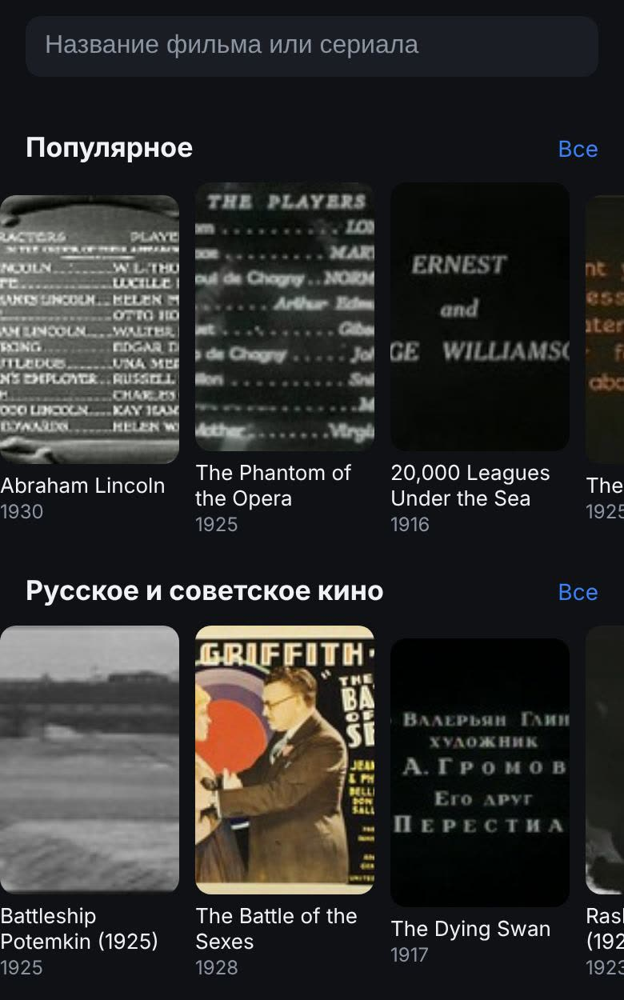
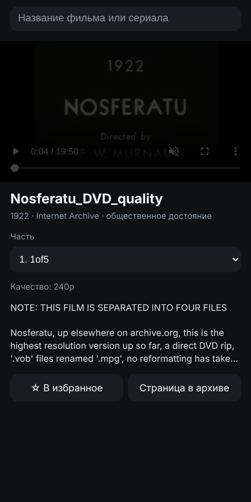
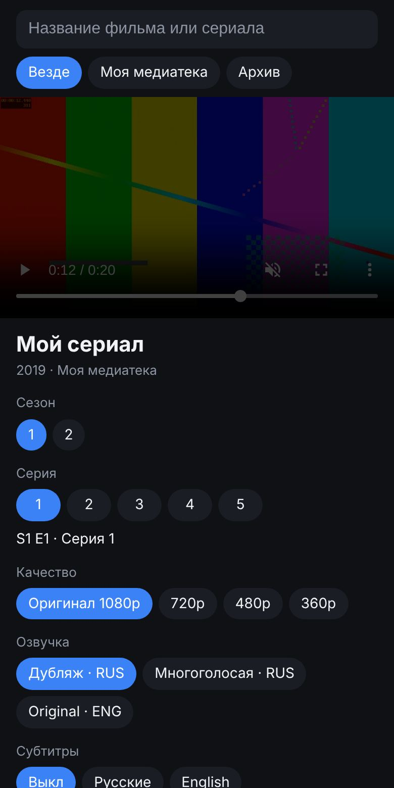

# Кино-бот для Telegram

Бот и встроенный в Telegram кинотеатр (мини-приложение): поиск, подборки, плеер с выбором качества, озвучки и субтитров,
«продолжить просмотр», избранное, автопереход к следующей серии. **Без рекламы, без VIP и подписок.**

Работает в облаке Cloudflare (бесплатно, круглосуточно), поэтому ПК не нужен: ставится и настраивается целиком с телефона
за 10–15 минут, смотреть можно прямо в Telegram на телефоне.

| Главная | Фильм из архива | Своя медиатека: сезоны, качество, озвучка |
|---|---|---|
|  |  |  |

## Откуда фильмы

Бот работает только с легальными источниками:

* **🎞 Internet Archive.** Классика в общественном достоянии: всё, что вышло 96 и более лет назад (в 2026 году это фильмы
  по 1930 год включительно; граница сама сдвигается каждый январь), из курируемых коллекций архива. Это немое кино,
  первые звуковые фильмы, Чаплин, Китон, Эйзенштейн, Вертов, ранняя анимация, плюс документальный архив Прелинджера.
  Фильмы, которые пользователи залили в архив в обход авторских прав, бот не показывает.
* **🏠 Ваша медиатека Jellyfin** (по желанию). Ваши собственные фильмы и сериалы. Именно здесь работает всё «как в
  больших ботах»: **выбор озвучки** (каждая аудиодорожка в файле — отдельная озвучка), **качество** от оригинала до 360p
  (сервер пережимает на лету), субтитры, сезоны и серии.

Новинок кино с русской озвучкой здесь нет и не будет: их легально показывают только платные сервисы со своими
приложениями. Боты, которые раздают новинки бесплатно, берут видео с пиратских сайтов, поэтому этот бот так не делает.

## Установка с телефона

Понадобятся Telegram и браузер. Компьютер не нужен.

### 1. Создайте бота

1. В Telegram откройте [@BotFather](https://t.me/BotFather), отправьте `/newbot`.
2. Придумайте имя (например, «Мой кинотеатр») и адрес, который кончается на `bot`.
3. BotFather пришлёт **токен** вида `1234567890:AAH...`. Скопируйте его, он понадобится в шаге 3.

### 2. Создайте воркер на Cloudflare

1. Зарегистрируйтесь на [dash.cloudflare.com/sign-up](https://dash.cloudflare.com/sign-up) (почта и пароль, карта не нужна)
   и подтвердите почту.
2. В меню откройте **Workers & Pages** (или **Compute → Workers**) → **Create** → **Create Worker** («Start with Hello World»).
3. Назовите его, например, `kino-bot` и нажмите **Deploy**.
4. Нажмите **Edit code**. Откроется редактор с примером кода.
5. В другой вкладке откройте файл [worker.js](worker.js) на GitHub и скопируйте его целиком: кнопка **Copy raw file**
   (два квадратика над кодом). Если кнопки нет, нажмите **Raw**, затем долгий тап по тексту → «Выбрать всё» → «Копировать».
6. Вернитесь в редактор Cloudflare, выделите весь пример, вставьте скопированный код и нажмите **Deploy**.

### 3. Добавьте токен

1. Откройте воркер → **Settings** → **Variables and Secrets** → **Add**.
2. Тип **Secret**, имя `BOT_TOKEN`, значение: токен из шага 1. Нажмите **Deploy** (или **Save**).

### 4. Подключите бота

Откройте в браузере адрес воркера с `/setup` на конце, например:

```
https://kino-bot.ВАШ-ПОДДОМЕН.workers.dev/setup
```

(адрес воркера показан на его странице в Cloudflare). Должно появиться «Готово!» и четыре зелёные галочки.

Всё: откройте своего бота в Telegram и нажмите «Запустить». Слева от поля ввода появится кнопка **Кино**.

## Как пользоваться

* **Напишите боту название**: он пришлёт кнопки с найденными фильмами, любая открывает плеер.
* **Кнопка «Кино»** (или «🎬 Открыть кинотеатр») открывает кинотеатр: поиск, подборки, «Продолжить просмотр», «Избранное».
* В плеере: выбор **части или серии**, **сезона**, **качества**, **озвучки**, **субтитров**. Выбор запоминается и применяется к
  следующим фильмам. Позиция просмотра сохраняется, следующая серия включается сама.
* В архиве в основном зарубежные фильмы с английскими названиями. Русские запросы бот переводит в латиницу
  («Броненосец» → «Bronenosets»), но надёжнее искать по-английски.
* Команда `/id` показывает ваш Telegram ID.

## Сделать бота личным

По умолчанию бот открыт для всех. Чтобы пускать только себя и близких:

1. Узнайте свой ID командой `/id` в боте (и ID тех, кого хотите пустить).
2. В Cloudflare добавьте переменную `ALLOWED_USERS` (тип Text) со списком ID через запятую: `123456789, 987654321`.
3. Нажмите Deploy. Остальным бот ответит, что он личный, и покажет их ID.

## Своя медиатека Jellyfin: озвучки, качество, сериалы

[Jellyfin](https://jellyfin.org) — бесплатный медиасервер для своих видеофайлов. Бот подключается к нему и показывает вашу
коллекцию в том же кинотеатре.

Что нужно:

* **Сервер Jellyfin, который всегда включён**: NAS, мини-ПК, старый ноутбук или Android TV-приставка. Сам бот по-прежнему
  живёт в облаке; от сервера нужно только, чтобы он был включён и раздавал файлы.
* **Доступ к серверу из интернета по https**. Проще всего бесплатный [Cloudflare Tunnel](https://developers.cloudflare.com/cloudflare-one/connections/connect-networks/)
  или обратный прокси с сертификатом. Адрес вида `http://192.168.…` не подойдёт: телефон должен достучаться до сервера
  из любой сети, а Telegram требует https.
* **Отдельный пользователь Jellyfin для бота** без прав администратора (Панель управления → Пользователи → «+»), с доступом
  к нужным библиотекам. Его токен попадает в ссылки на видео у ваших зрителей, поэтому админа сюда не ставьте.

Переменные в Cloudflare:

| Имя | Тип | Значение |
|---|---|---|
| `JELLYFIN_URL` | Text | `https://jellyfin.example.com` |
| `JELLYFIN_USER` | Text | имя пользователя для бота |
| `JELLYFIN_PASSWORD` | Secret | его пароль |
| `ALLOWED_USERS` | Text | ваши ID через запятую (**обязательно**: без него медиатека выключена) |

После Deploy в кинотеатре появятся вкладки «Везде / Моя медиатека / Архив» и подборка «Моя медиатека: новое».
Озвучки берутся из аудиодорожек файла: подпишите дорожки (поле Title, например «Дубляж», «Многоголосая», «Оригинал»),
и бот покажет их по этим названиям. Качество ниже оригинала сервер готовит на лету, для этого ему нужен ffmpeg
(в стандартных сборках Jellyfin он есть).

В разделе «Устройства» Jellyfin могут появляться записи «Telegram bot». Это входы бота, так и задумано.

## Обновление

Скопируйте новый `worker.js` в редактор Cloudflare так же, как при установке, и нажмите Deploy. Переменные сохранятся,
`/setup` повторять не нужно (но и не вредно).

## Если что-то не работает

| Что видно | Что сделать |
|---|---|
| `/setup` пишет «Не хватает токена» | Переменная `BOT_TOKEN` не добавлена или не нажат Deploy после добавления. |
| `/setup` пишет «Неверный токен» | Скопируйте токен у @BotFather заново (`/mybots` → бот → API Token). |
| Бот молчит | Откройте `/setup` ещё раз. Если адрес воркера менялся, вебхук нужно перерегистрировать. |
| Кинотеатр не открывается, белый экран | Возможно, адреса `*.workers.dev` у вас блокируются. Подключите свой домен к воркеру (Settings → Domains & Routes), добавьте переменную `PUBLIC_URL` с этим адресом и откройте `/setup` по новому адресу. |
| «Откройте кинотеатр через бота» | Бот личный (`ALLOWED_USERS`), а страницу открыли в обычном браузере. Откройте через кнопку в боте. |
| Видео из архива не играет | Переключите качество. Если не играет ни одно, этот файл не поддерживается телефоном: откройте «Страница в архиве». |
| «Jellyfin не пустил» | Проверьте `JELLYFIN_URL` (полный адрес с `https://`), имя и пароль пользователя. |
| «Медиатека не отдала видео» | Сервер Jellyfin выключен, недоступен из интернета или не по https. |

## Ограничения

* Бесплатный тариф Cloudflare: 100 000 запросов в сутки. Для себя и семьи этого хватает с огромным запасом.
* Видео идёт напрямую с серверов архива или вашего Jellyfin, через Cloudflare проходят только поиск и страницы.
* «Продолжить просмотр» и «Избранное» хранятся на самом телефоне: на другом устройстве списки будут свои.

## Для разработчиков

* `worker.js` — весь бот одним файлом: вебхук Telegram, API для мини-приложения, мини-приложение (HTML внутри файла).
* `tests/test_worker.mjs` — проверки (Telegram и Jellyfin подменены заглушками, Internet Archive настоящий):
  `node kino-bot/tests/test_worker.mjs` (без интернета: `SKIP_NETWORK=1`).
* `tests/dev_server.mjs` — запуск мини-приложения локально: `node kino-bot/tests/dev_server.mjs` → http://127.0.0.1:8787/.
* С компьютера можно поставить и так: `cd kino-bot && npx wrangler deploy && npx wrangler secret put BOT_TOKEN`.
