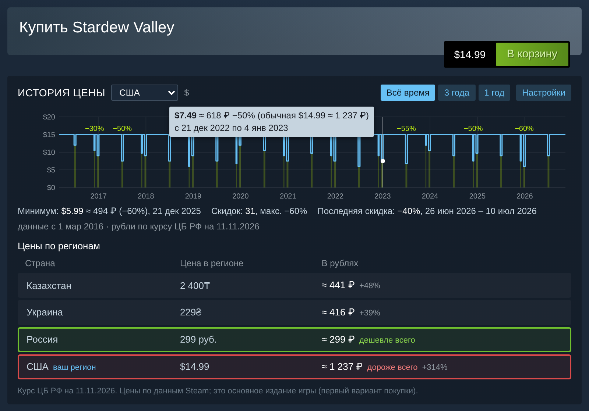

# Steam Price Chart: история цены и цены по регионам

Расширение для магазина Steam, которое работает **в самом клиенте Steam** (через Millennium) и **в браузере**
(Chrome, Edge, Яндекс Браузер, Opera, Firefox). Когда вы открываете игру в магазине, под её ценником появляются:

1. **Мини-график цены за всё время.** На нём видно, когда была скидка и сколько процентов (зелёные провалы с
   подписью «−50%»). Если навести мышь, появится точная цена и даты. Переключатели «Всё время / 3 года / 1 год».
   Под графиком сводка: минимальная цена и когда она была, сколько всего было скидок, максимальная скидка,
   последняя скидка (или «сейчас скидка −N%»).
   **График в валюте выбранного региона** (по умолчанию ваш регион, переключается списком прямо над графиком).
   Рядом с ценами графика (в подсказке при наведении и в сводке) показан их перевод в рубли по курсу ЦБ РФ на
   сегодня, так же, как в таблице. Это пересчёт цены выбранного региона, а не цена российского региона.
2. **Таблица цен по регионам: Казахстан, Украина, Россия, США.** Столбцы: страна, цена в местной валюте
   (₸, ₴, руб., $), цена в рублях по курсу ЦБ РФ. **Самый дешёвый вариант обведён зелёным, самый дорогой красным.**
   Рядом с рублёвой ценой показано, на сколько процентов она дороже самой дешёвой.
   Ваш регион Steam определяется автоматически и помечается «ваш регион». Если его нет среди этих четырёх,
   он добавляется в таблицу пятой строкой.



*На снимке страница магазина США и настоящие цены Steam на 11.11.2026. История цены на графике здесь тестовая:
для настоящей нужен ключ IsThereAnyDeal (см. ниже).*

---

## Установка в клиент Steam (Windows)

Valve официально не поддерживает расширения для клиента, поэтому используется **Millennium**. Это открытый
модлоадер для клиента Steam (https://steambrew.app), через него работают все известные плагины клиента.

1. **Поставьте Millennium.** Скачайте установщик на https://steambrew.app и запустите его. Steam перезапустится.
2. **Поставьте Bun** (нужен один раз, чтобы собрать плагин). Откройте PowerShell и выполните:
   ```powershell
   powershell -c "irm bun.sh/install.ps1 | iex"
   ```
   Закройте и снова откройте PowerShell.
3. **Скачайте этот репозиторий**: на GitHub кнопка **Code → Download ZIP**, распакуйте архив.
4. **Соберите плагин.** В PowerShell перейдите в папку `steam-price-chart\millennium` внутри распакованного архива
   и выполните:
   ```powershell
   cd "C:\путь\к\папке\steam-price-chart\millennium"
   bun install
   bun run build
   ```
   Сборщик Millennium сам найдёт установленный Millennium и положит плагин в него.
5. **Включите плагин.** Перезапустите Steam, откройте настройки Millennium (в меню Steam или в настройках Steam,
   раздел Millennium), вкладка **Plugins**, включите **Steam Price Chart**. Если Millennium попросит, перезапустите
   Steam ещё раз.
6. Откройте любую игру в магазине Steam: виджет появится под ценой.

## Ключ IsThereAnyDeal (нужен для графика)

Таблица цен по регионам работает сразу. Историю цены Steam не отдаёт, её ведёт сайт **IsThereAnyDeal**, и для
доступа к нему нужен бесплатный личный ключ:

1. Зарегистрируйтесь или войдите на https://isthereanydeal.com.
2. Откройте https://isthereanydeal.com/apps/my/ и зарегистрируйте приложение (кнопка **Register app**,
   название любое, например «Steam Price Chart»).
3. Откройте своё приложение и скопируйте значение **API key**. Это отдельное поле: **Client ID** и **Client Secret**
   из раздела **OAuth** не подходят.
4. На странице любой игры в магазине нажмите **Настройки** в виджете, вставьте ключ и нажмите **Сохранить**.

Ключ хранится только у вас (в настройках Millennium или в хранилище браузера) и отправляется только на
`api.isthereanydeal.com`.

В настройках виджета также можно выбрать:
* **Регион для графика** (по умолчанию ваш регион; быстрее переключать списком над графиком). График всегда
  в валюте этого региона. Если у IsThereAnyDeal есть история цен Steam в этой валюте, показывается она. Если нет
  (например, для тенге), история пересчитывается: даты и проценты скидок берутся из истории IsThereAnyDeal
  (при необходимости по США: процент скидки на распродажах Steam обычно одинаковый во всех регионах), а обычная
  цена равна нынешней цене Steam в выбранном регионе. Тогда над графиком написано «пересчитано по скидкам»;
  если Steam когда-то менял цену только в этом регионе, на пересчитанном графике этого не видно. Если игра в
  регионе не продаётся, показывается история США в долларах, и это тоже подписано.
* **Ваш регион** (по умолчанию определяется по аккаунту Steam, которым вы вошли в магазин): строка с пометкой
  «ваш регион» в таблице. Если вы не вошли в аккаунт, Steam определяет страну по IP-адресу.

## Установка в браузер

**Chrome, Edge, Яндекс Браузер, Opera**
1. Скачайте репозиторий (Code → Download ZIP) и распакуйте.
2. Откройте `chrome://extensions` (в Edge `edge://extensions`, в Яндексе `browser://extensions`).
3. Включите **Режим разработчика**, нажмите **Загрузить распакованное расширение** и выберите папку
   `steam-price-chart/browser-extension`.

**Firefox**
1. Откройте `about:debugging#/runtime/this-firefox`, нажмите **Загрузить временное дополнение** и выберите файл
   `steam-price-chart/browser-extension/manifest.json`. Временное дополнение работает до перезапуска Firefox.
2. В `about:addons`, на странице расширения, вкладка **Разрешения**: разрешите доступ к сайтам
   (Firefox не выдаёт его автоматически).

Ключ IsThereAnyDeal в браузере вводится отдельно, той же кнопкой **Настройки** в виджете.

---

## Откуда данные

| Что | Источник |
|---|---|
| Цены в регионах | сам Steam: `store.steampowered.com/api/appdetails?cc=kz/ua/ru/us` |
| Курс в рубли | ЦБ РФ (`cbr-xml-daily.ru`); если он недоступен, `fawazahmed0/currency-api` |
| История цены и скидок | IsThereAnyDeal API, только магазин Steam, вся история (`since=2000-01-01`); в валюте региона, при необходимости пересчитана от нынешней цены Steam в регионе |

Ответы кэшируются, чтобы не дёргать сайты на каждой странице: цены 30 минут, курс и история 6 часов.
Кнопка **Сбросить кэш** в настройках скачивает всё заново.

## Что нужно знать

* В таблице цена **основного издания** (первого варианта покупки на странице). Deluxe-издания и наборы не учитываются.
* «Не продаётся в регионе» означает, что Steam не продаёт игру в этой стране (часто бывает для России).
* Рубли посчитаны по официальному курсу ЦБ. Реальная стоимость пополнения кошелька в другом регионе обычно выше
  из-за комиссий.
* История у IsThereAnyDeal начинается с момента, когда сайт начал следить за игрой (подпись «данные с …»).
* Millennium сторонний мод клиента. После крупных обновлений Steam он иногда временно перестаёт работать, пока
  авторы Millennium не выпустят исправление.

## Если не заработало

* **Окно «Плагин Steam Price Chart неожиданно завершил работу».** Скорее всего, у вас старая версия: в версии 1.0.0
  бэкенд падал при запуске. Обновите плагин (см. ниже). Если окно появляется и на новой версии, нажмите в нём
  **Просмотреть логи** и приложите текст логов к сообщению об ошибке.
* **Как обновить плагин.** Скачайте репозиторий заново, в папке `steam-price-chart\millennium` снова выполните
  `bun install` и `bun run build`, перезапустите Steam.
* **Виджета нет в клиенте.** Проверьте, что плагин включён в Millennium → Plugins, и перезапустите Steam. Ошибки
  плагина видны в логах Millennium (строки с `Steam Price Chart`).
* **«IsThereAnyDeal не принял ключ» (HTTP 403).** Чаще всего вставлен Client ID или Client Secret из раздела OAuth.
  Откройте своё приложение на https://isthereanydeal.com/apps/my/ и скопируйте именно **API key**, без пробелов.
* **`bun` не найден.** Закройте и снова откройте PowerShell после установки Bun.

---

## Для разработчиков

```
steam-price-chart/
  core/steam-price-chart.js         общий код: данные, график, таблица, настройки (правьте только его)
  millennium/                       плагин Millennium для клиента Steam
    millennium.toml                 манифест плагина
    backend/rpc_functions.lua       прокси для запросов на внешние сайты + хранение настроек
    webview/preload.ts              адаптер для страниц магазина в клиенте
    webview/steam-price-chart.js    копия ядра
    frontend/index.tsx              страница плагина в настройках Millennium
  browser-extension/                расширение Manifest V3 (Chrome и Firefox)
    background.js                   прокси для запросов
    content.js                      адаптер
    steam-price-chart.js            копия ядра
  tools/sync-core.mjs               копирует ядро в оба места
  tests/                            тесты
```

Почему запросы идут через бэкенд: политика безопасности (CSP) страниц магазина Steam разрешает странице
обращаться только к сайтам Valve. Поэтому IsThereAnyDeal и курсы валют скачивает Lua-бэкенд плагина (в браузере
это делает `background.js`). Оба пропускают только GET-запросы к сайтам из короткого списка.

После правки ядра:
```bash
node tools/sync-core.mjs            # обновить копии
node tools/sync-core.mjs --check    # проверить, что копии совпадают
node --test tests/unit.test.mjs     # расчёты графика
node tests/e2e.cjs                  # виджет в Chromium (нужен playwright)
lua tests/backend.test.lua          # Lua-бэкенд с заглушками Millennium
```
